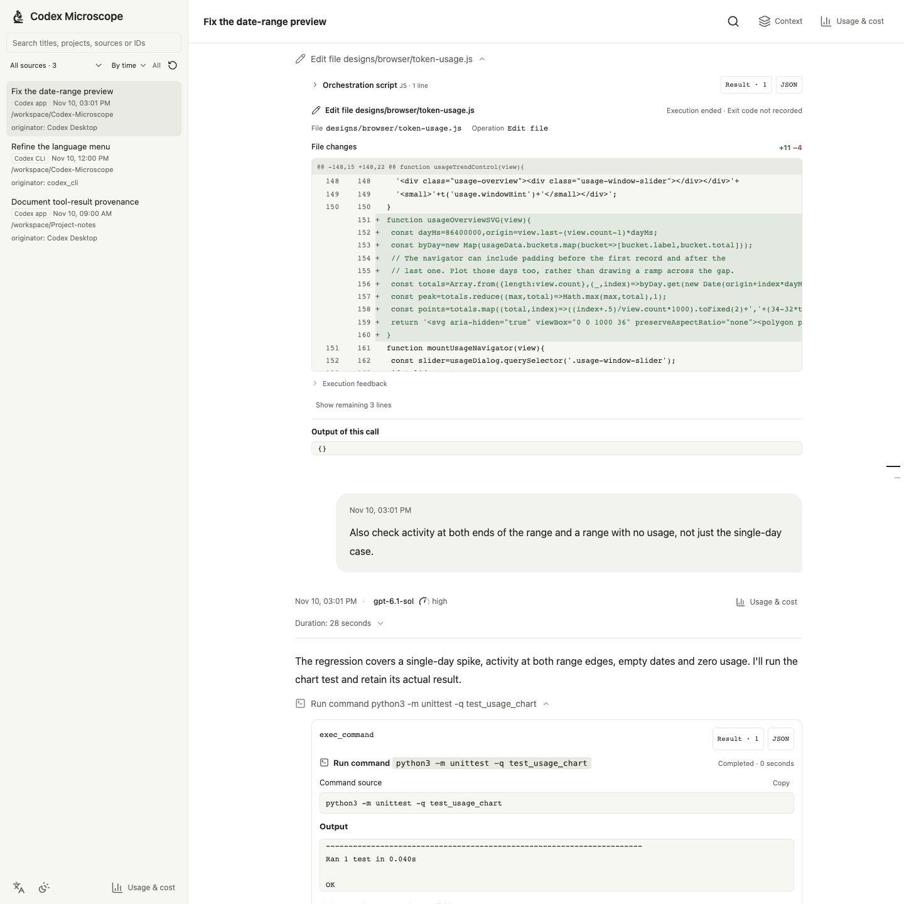
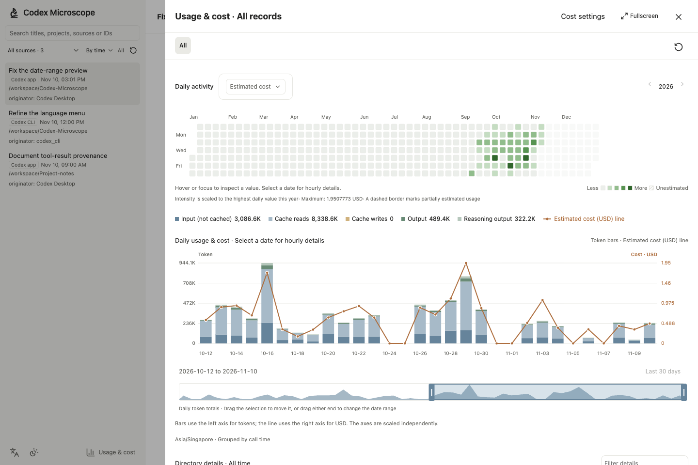
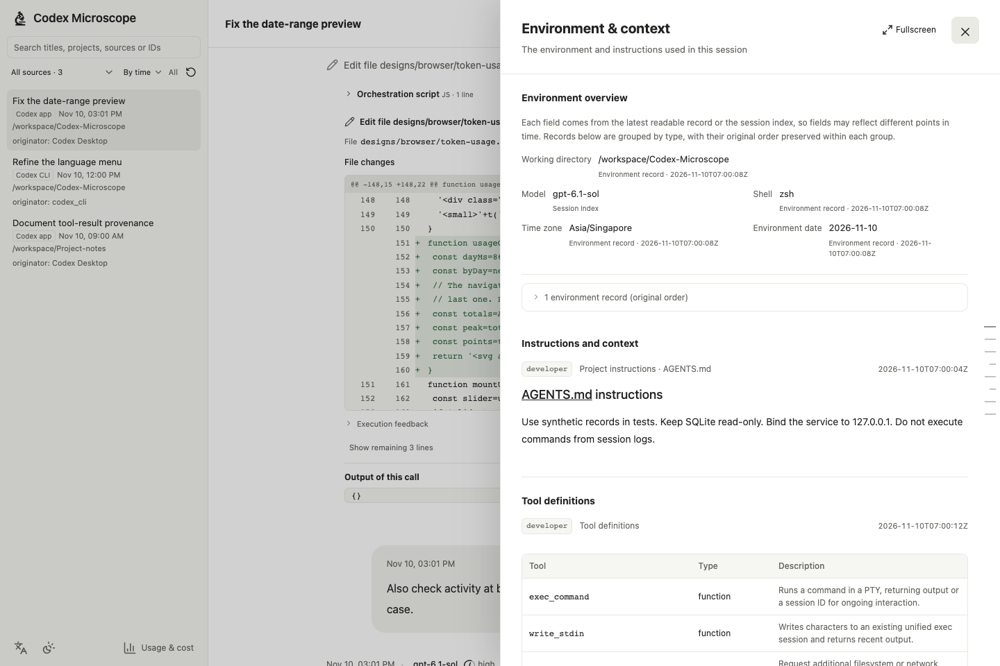
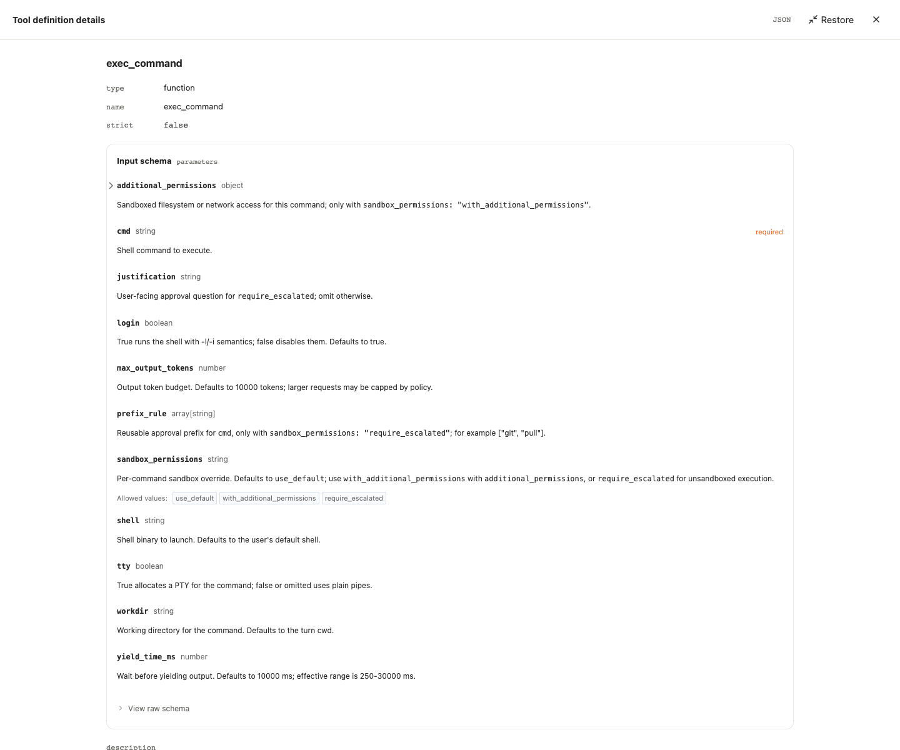

# Codex Microscope

**English** · [简体中文](README.zh-CN.md)

**See what Codex did, and understand the usage it recorded.**

A local, read-only browser for Codex sessions. Revisit conversations, inspect tool execution and file diffs, examine recorded context, and explore token usage and estimated costs by session, directory or time.

**Local records · No pip/npm install to run · English & Chinese UI · MIT**

[Quick start](#quick-start) · [Features](#features) · [Detailed guide (中文)](docs/guide.md) · [Privacy & limitations](#privacy--limitations)

## Features

### Follow each tool operation

File reads, searches, edits, terminal commands and MCP calls have their own details. Expand an operation to see command source, exit codes, output, line-numbered content and raw records. File changes include added/deleted line counts and diffs with old and new line numbers.

Inspect individual operations within an orchestration and the results that can be attributed to them. Ambiguous results stay shared; missing output and failures remain explicit.



### Go from a year of activity to a single hour

Explore **all records → directory → session → turn**. Find active dates in the annual heatmap, drill into hourly details, and drag or resize the date window.

- Token breakdowns, cache hit rates, model details and estimated costs share the selected scope.
- Choose **API-equivalent cost** or **credits usage / converted cost**.
- Unknown costs remain unestimated, and partial estimates have distinct markers.



### Inspect the context behind a session

View the recorded model, reasoning effort, working directory, environment, permissions, instructions and tool definitions for a session or turn. Inspect tool inputs in the local JSON Schema viewer, with access to the original schema and JSON.



### Explore tool input schemas

Open a tool definition to inspect parameter types, required fields, defaults, constraints and nested objects. The example shows Codex’s actual `exec_command` schema, including `cmd`, `workdir` and permission options. The fullscreen viewer keeps the original schema and JSON available alongside the structured view.



The walkthrough reconstructs a public bug fix in this repository using **real source, the committed diff and fresh test output**. Tool schemas come from public Codex definitions. Usage is simulated and priced with a dated public snapshot; it is not a bill. No private conversation is reproduced. [Screenshot sources](docs/fixtures/README.md)

### Read long sessions comfortably

| Feature | What it does |
| --- | --- |
| Find past work | Filter by source, group by time or directory, search titles, projects, paths and IDs, and browse archived sessions |
| Search a whole session | Find text in loaded and unloaded messages and tool output, then step through matches |
| Load what you need | Start with the latest 8 turns, load earlier history, and fetch tool details when expanded |
| Follow live updates | Detect local record changes; show a new-message entry while preserving your place in history |
| Preview subagents | Check related sessions, status, recent messages and actions before opening the full session |
| Make it yours | Light/dark themes, narrow layouts, and a language-icon menu for English, 简体中文 or following the browser; preferences stay in that browser |

## Quick start

Requires **Python 3.10+** and existing Codex session records on your machine.

```sh
git clone https://github.com/JinhaoPlus/Codex-Microscope.git
cd Codex-Microscope
python3 server.py
```

Open **[http://localhost:4318](http://localhost:4318)**. You can also download the source ZIP, extract it and run `python3 server.py` from the project directory.

```sh
# Optional: choose another port or an existing Codex data directory
python3 server.py --port 4320
CODEX_HOME=/path/to/your/codex python3 server.py
```

| Task | Additional requirement |
| --- | --- |
| Read ordinary JSONL records | Python standard library; no pip install or Node build |
| Read zstd-compressed records | Python 3.14+, or a system `zstd` executable (`brew install zstd` on macOS) |
| Refresh cached prices | System `curl`, included with macOS; HTTPS certificate verification stays enabled |
| Rebuild the bundled Schema viewer or run browser checks | Optional Node/npm; see the [component guide](scripts/schema-viewer/README.md) |

Homebrew Python is recommended on macOS. Run `python3 diagnose_sqlite.py` if SQLite reads fail. The [detailed guide (中文)](docs/guide.md) covers runtime diagnostics, macOS background services, updates and restarts. Validation has primarily been on macOS.

## How usage and cost work

Token usage comes from local records. Costs are estimates based on cached public rates or your credits conversion rule. **They are not actual bills.**

On first use, open **Cost settings → Refresh cache** to download prices. To convert credits into money, enter the amount paid in USD and the credits received. Missing prices, models or speed tiers are shown with an explanation.

Preferences and price snapshots live in this project's `.local/pricing/` directory. They stay local and do not automatically migrate when you change project directories. Directory totals use the working directory recorded at each call, excluding subdirectories. [Full methodology (中文)](docs/guide.md#用量与成本)

## Privacy & limitations

- **Local and read-only.** Session reads, search and aggregation run on your machine. The app does not upload conversations or connect to Codex cloud services. SQLite connections are read-only; SQLite may still create WAL/SHM coordination files.
- **Price refreshes use the network.** Prices are downloaded from the selected LiteLLM, models.dev or official credits source, without conversation text, directories or usage data. Failed refreshes preserve the previous cache.
- **Loopback only.** The server binds to `127.0.0.1`, checks Host and has no login. Do not expose it through a public listener or unauthenticated proxy. A narrow layout does not make your computer's localhost accessible from a phone.
- **Original content stays original.** Changing the UI language does not translate conversations, commands, output or paths. Check screenshots and copied content for private information; credential masking is not comprehensive redaction.
- **Only saved local records are available.** The app reads sessions in the local index. It does not sync devices or recover unsaved content. Internal Codex formats can change, and parsing or searching very long sessions may take more time and memory.

## Development & contributions

Python standard-library server and plain JavaScript, with locally bundled Markdown, syntax highlighting, icons and Schema viewer assets. See [AGENTS.md](AGENTS.md) for engineering conventions.

```sh
python3 -m unittest -v
python3 scripts/check_locales.py
# Optional: requires Node.js
node --check designs/browser/app.js
```

Refresh the page after frontend changes; restart the server after backend changes. Localization, optional browser checks and reproducible screenshots are documented in the [detailed guide (中文)](docs/guide.md#开发). Use synthetic data in bug reports and include your OS, Python and Codex versions.

Codex Microscope is an independent project, not an official OpenAI product. Original code and the project's own icon use the [MIT license](LICENSE). Bundled dependencies retain their own licenses; see [THIRD_PARTY_NOTICES.md](THIRD_PARTY_NOTICES.md).
