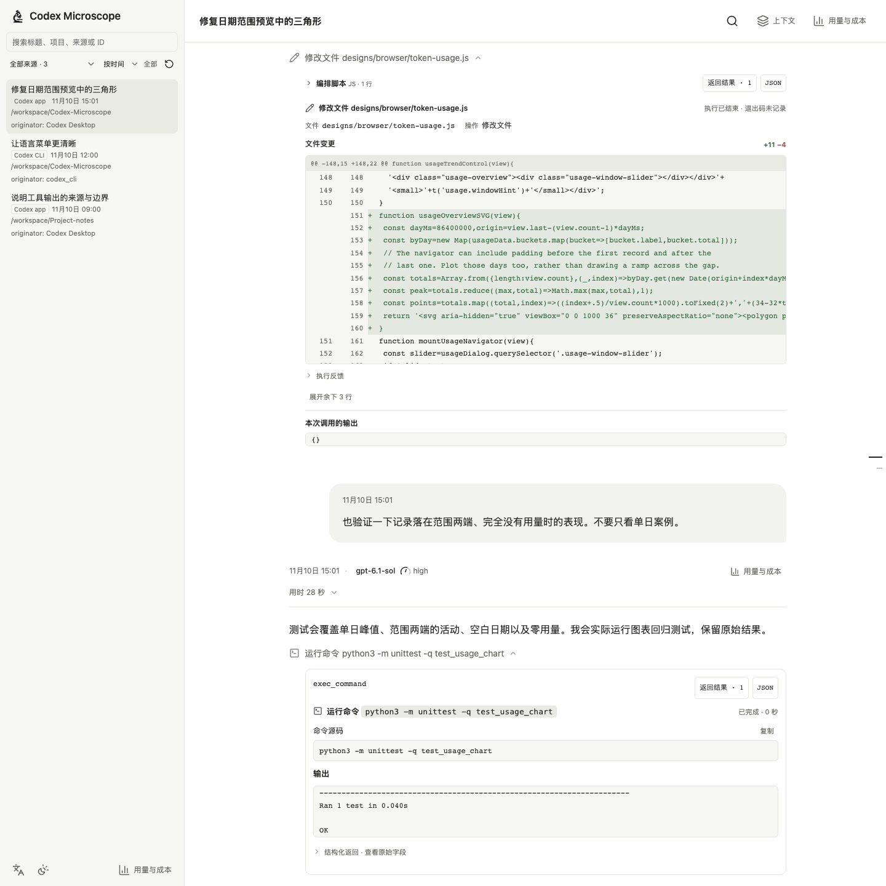
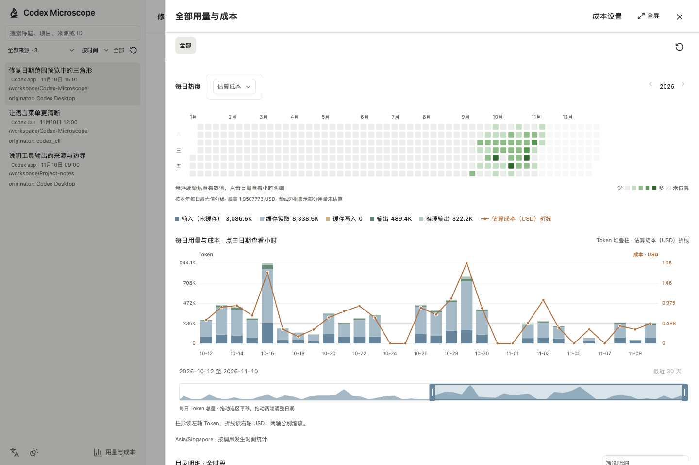
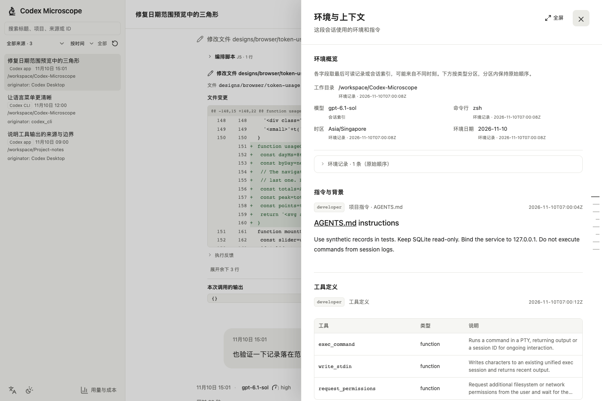
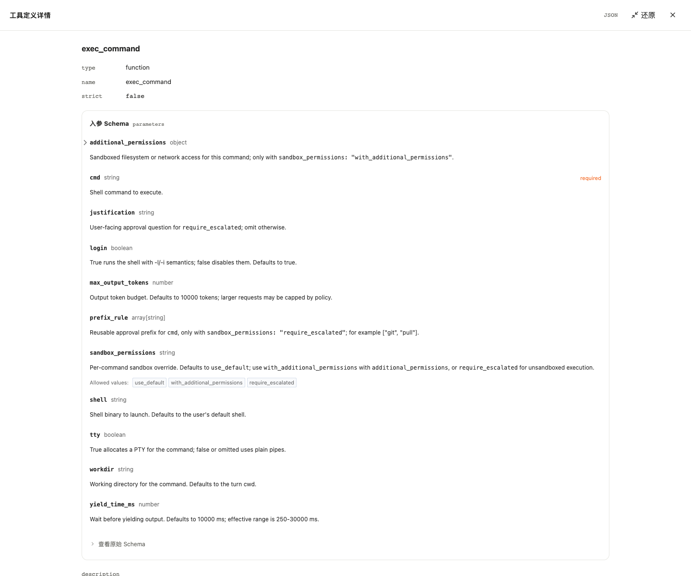

# Codex Microscope

[English](README.md) · **简体中文**

**看清 Codex 做了什么，以及记录了多少用量。**

A local, read-only browser for Codex sessions.

在浏览器里回看本机 Codex 会话，逐项检查工具调用、命令输出与文件 diff，查看当时的上下文，再按会话、目录或时间分析 Token 用量与估算成本。

**本机读取 · 无需 pip/npm 安装即可运行 · 中英界面 · MIT**

[快速开始](#快速开始) · [功能展示](#功能展示) · [使用指南](docs/guide.md) · [隐私与边界](#隐私与边界)

## 功能展示

### 看懂一次工具执行

文件读取、搜索、修改、终端命令和 MCP 调用各自展示清晰的操作详情。展开即可查看命令源码、退出码、输出、带行号的内容和原始记录；文件修改提供增删统计与双行号 diff。

同一批编排可以拆开看每个操作及其结果。输出归属无法确认时保留共享输出，缺失或失败也会明确标注。



### 从全年活动下钻到某个小时

按**全部记录 → 目录 → 会话 → 轮次**查看用量；用年度热度网格发现活跃日期，再下钻到小时。日期滑块支持移动或调整统计窗口。

- Token 类型堆叠、缓存命中率、模型明细与估算成本共用当前统计范围。
- 支持 **API 等价成本**及 **credits 消耗／折算成本**两种口径。
- 未知成本保持未估算；部分可估价与完整可估价有不同标记。



### 查清当时用了什么上下文

查看会话或轮次记录中的模型、推理力度、工作目录、环境、权限、指令与工具定义。工具入参支持本地 JSON Schema 查看器，并保留原始 Schema 和 JSON 入口。



### 展开工具的参数 Schema

从工具定义打开参数详情，查看字段类型、必填项、默认值、约束和嵌套对象。图中展示 Codex 实际的 `exec_command` Schema，包括 `cmd`、`workdir` 与权限选项。全屏查看器将参数结构展开，同时保留原始 Schema 与 JSON 入口。



截图以本仓库的公开修复重建排查过程，使用**真实源码、已提交的 diff 与现场运行的测试输出**。工具 Schema 来自 Codex 公开定义。用量为模拟数据，价格使用注明日期的公开快照，不代表真实账单，也未复用私人会话。[截图数据来源](docs/fixtures/README.md)

### 阅读长会话也保持顺手

| 功能 | 使用方式 |
| --- | --- |
| 找到历史记录 | 按来源筛选、按时间或目录组织，搜索标题、项目、路径和 ID，查看归档会话 |
| 搜索完整会话 | 查找已加载与尚未加载的正文及工具输出，逐个跳转到命中位置 |
| 按需阅读 | 默认加载最近 8 轮，继续向前翻页；工具输入和输出展开时再读取 |
| 跟上新消息 | 自动检查记录变化；阅读历史时显示新消息入口，保留当前阅读位置 |
| 查看子代理 | 先预览关联会话的状态、最近消息和操作，再决定是否打开完整会话 |
| 选择熟悉的界面 | 深浅色与窄屏布局；语言图标切换简体中文、English 或跟随浏览器，选择保存在当前浏览器 |

## 快速开始

需要 **Python 3.10+** 和本机已有的 Codex 会话记录。

```sh
git clone https://github.com/JinhaoPlus/Codex-Microscope.git
cd Codex-Microscope
python3 server.py
```

打开 **[http://localhost:4318](http://localhost:4318)**。也可以下载源码 ZIP，解压后运行 `python3 server.py`。

```sh
# 可选：更换端口或指定已有的 Codex 数据目录
python3 server.py --port 4320
CODEX_HOME=/path/to/your/codex python3 server.py
```

| 场景 | 额外要求 |
| --- | --- |
| 读取普通 JSONL | Python 标准库即可，无需 pip 或 Node 构建 |
| 读取 zstd 压缩记录 | Python 3.14+，或安装系统 `zstd`（macOS：`brew install zstd`） |
| 更新价格缓存 | 系统 `curl`；macOS 自带，下载始终校验 HTTPS 证书 |
| 更新预打包 Schema 组件、运行浏览器回归 | 可选 Node/npm，见[组件说明](scripts/schema-viewer/README.md) |

macOS 建议使用 Homebrew Python。遇到 SQLite 读取问题可运行 `python3 diagnose_sqlite.py`；[使用指南](docs/guide.md)包含运行时诊断、常驻服务、更新及重启步骤。当前主要在 macOS 验证。

## 用量与成本怎么计算

Token 数据来自本地记录；成本按缓存的公开单价或自设的 credits 换算规则估算，**不代表实际账单**。

首次使用时，打开 **Cost settings / 成本设置 → Refresh cache / 刷新缓存**。使用 credits 折算金额时，还需填写支付金额（USD）和获得的 credits。未缓存价格、缺少模型或速度档位时，会显示无法估价的原因。

换算设置与价格缓存位于本项目的 `.local/pricing/`，只在本机保存；更换项目目录不会自动迁移。目录统计按调用时的工作目录精确归属，不包含子目录。[完整统计说明](docs/guide.md#用量与成本)

## 隐私与边界

- **本地、只读。** 会话读取、搜索和聚合在本机进行，不上传会话内容，不连接 Codex 云端；SQLite 使用只读连接。标准 SQLite 可能创建协调读取所需的 WAL/SHM 辅助文件。
- **价格更新会联网。** 仅向所选 LiteLLM、models.dev 或官方 credits 数据源下载价格，不附带会话正文、目录或用量；失败时保留已有缓存。
- **只监听本机。** 服务绑定 `127.0.0.1` 并检查 Host，无登录认证。不要直接暴露到公网或无认证代理。窄屏适配不等于手机能够直接访问电脑的 localhost。
- **原始内容保留。** 切换语言不会翻译会话原文、命令、输出或路径。分享截图和复制内容前仍需检查隐私；凭据遮盖不能替代完整脱敏。
- **依赖已有记录。** 读取本机索引内的会话，不同步其他设备或还原未保存的内容。Codex 内部格式可能随版本变化；极长会话的完整解析与搜索仍可能消耗较多内存和时间。

## 开发与贡献

Python 标准库服务 + 原生 JavaScript，Markdown、高亮、图标与 Schema 查看器均本地提供。维护约定见 [AGENTS.md](AGENTS.md)。

```sh
python3 -m unittest -v
python3 scripts/check_locales.py
# 可选，需要 Node.js
node --check designs/browser/app.js
```

前端修改刷新即可生效；后端修改需要重启服务。多语言配置、浏览器回归和截图复现见[使用指南](docs/guide.md#开发)。问题报告请使用合成数据，注明系统、Python 和 Codex 版本。

本项目为独立工具，不属于 OpenAI 官方产品。原创代码和自有图标采用 [MIT](LICENSE)；第三方组件保留各自许可证，见 [THIRD_PARTY_NOTICES.md](THIRD_PARTY_NOTICES.md)。
